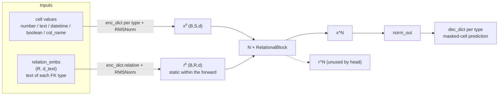
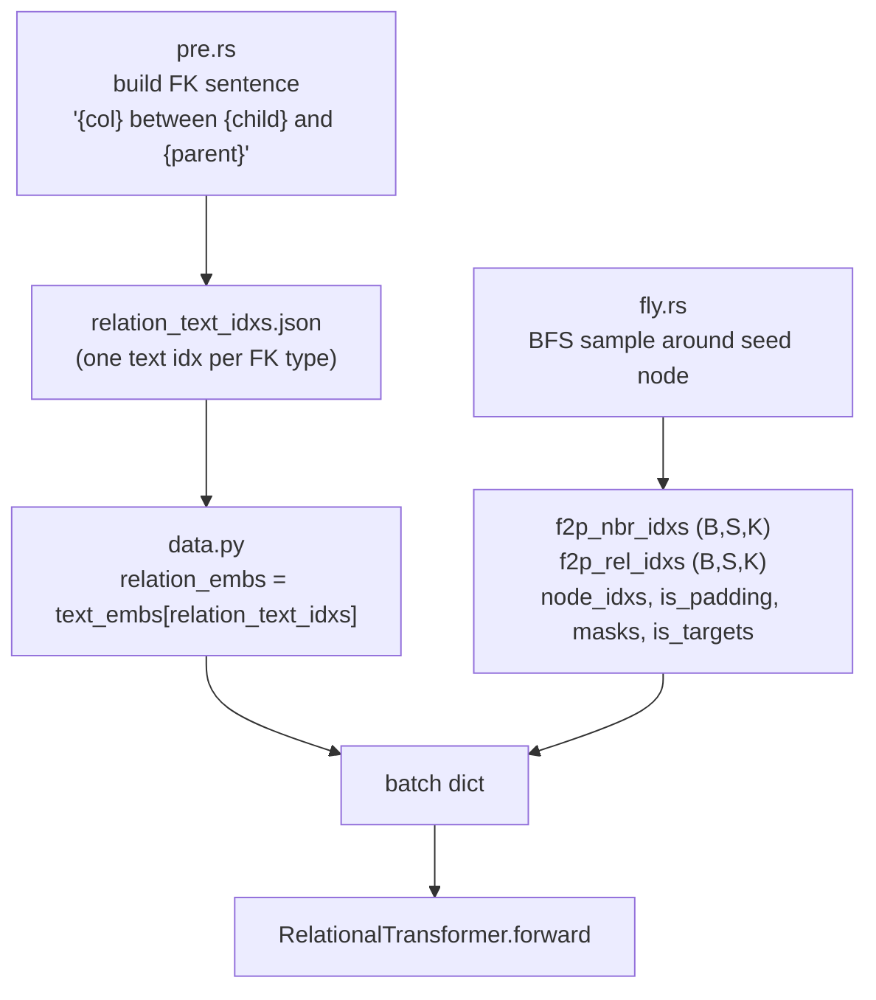
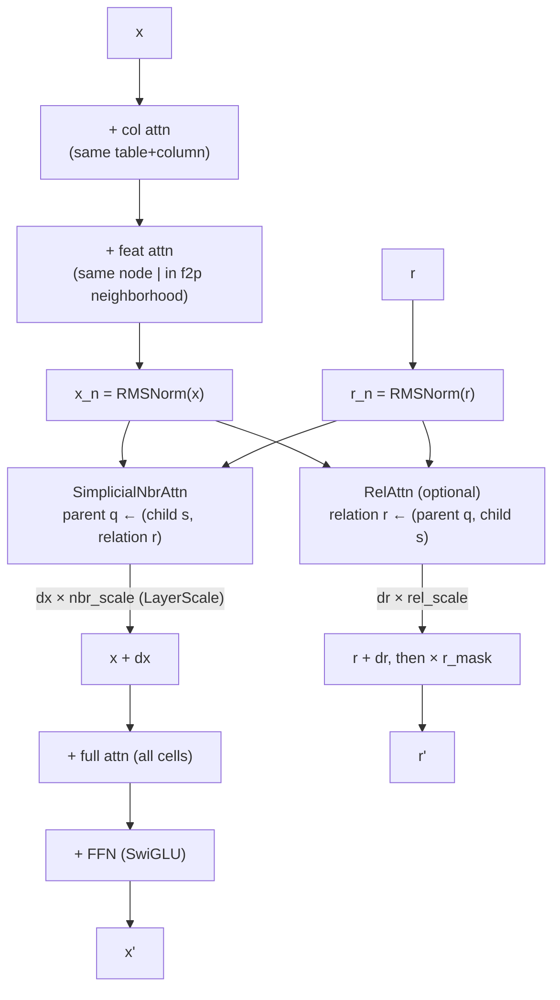
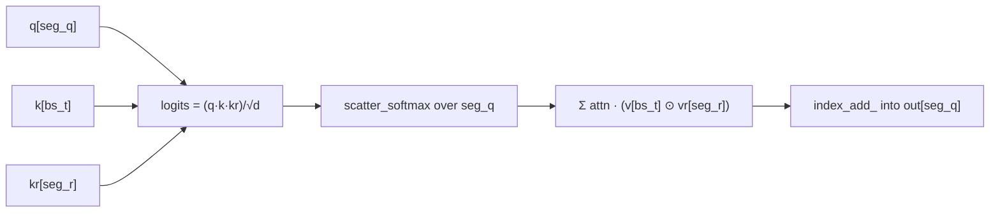

# Relation-aware simplicial attention (static text-relation route)

Zero-shot relational-table pretraining where **neighbor aggregation is conditioned
on the foreign-key type**, and each relation type is represented by the **text
embedding of its schema description** (e.g. `"director between movie and person"`).

The key speedrun result is **305.63 seconds (5m05.6s)** to the fixed pooled-AUROC
target, improving the previous 7m26s record. The record configuration keeps the
text-derived relation stream static between blocks (`update_relations=False`),
uses a long Muon warmup, and evaluates the first eligible post-update checkpoint
at step 100. “Static” refers to the within-forward relation state; the relation
encoder and neighbor-attention parameters remain trainable.

The canonical evidence is W&B run
[`ltlneqhn`](https://wandb.ai/franciscokunumi-universidade-federal-de-minas-gerais/nanort-train/runs/ltlneqhn),
which logged pooled AUROC `0.8713918` at the record-eligible step-100 evaluation.
The complete configuration and timing split are recorded in
[`RECORD_04_MANIFEST.md`](RECORD_04_MANIFEST.md).

An initialization audit measured pooled AUROC `0.8651` at step 0. This is logged
outside the timer and cannot select a record or checkpoint. It establishes that
the architecture/schema prior already clears the historical target, so the
result must be described as time-to-verified-solution rather than pure learning
speed. Per-task and within/cross-task diagnostics are reported alongside it.

---

## 1. The idea in one line

Conventional neighbor attention asks *"how relevant is child `s` to parent `q`?"*.
Here the score also depends on **which relation** connects them:

```
score(q, s, r) = Σ_d  q_d · k^cell_s,d · k^rel_r,d          (per head)
value(s, r)    = v^cell_s ⊙ v^rel_r                          (FiLM-style gate)
```

`r` is a per-relation-type embedding, initialised from text and — on the winning
route — **not iteratively updated** between blocks.

> Note (see `project_simplicial_diagnosis`): algebraically this is a rank-1
> DistMult/FiLM operator, not a true 2-simplex — `r` is glued to the edge and the
> softmax is segmented only by `q`. The name "simplicial" is historical.

---

## 2. Two streams

The model carries two token streams through every block:

- **`x` — cells** `(B, S, d)`: one token per (row, column) cell in the sampled subgraph.
- **`r` — relations** `(B, R, d)`: one token per foreign-key *type*, shared across
  all edges instantiating it.



Only `x` reaches the prediction head; `r` conditions `x` but is never decoded.

---

## 3. Data pipeline (leak-safe sampling)

The Rust extension (`rustler/`) builds the relation text and samples a temporal,
leak-free subgraph per seed node.



Leak prevention in `fly.rs` (validated):

| vector | mechanism | ref |
|---|---|---|
| temporal | edges with `timestamp > seed_node.timestamp` are skipped | `fly.rs:447` |
| target value | target cell gets `is_target` + `masks=True`; model uses `mask_emb` on input, value only as label | `fly.rs:528-532` |
| leaky columns | `columns_to_drop` removed from seed **and** same-timestamp nodes | `fly.rs:482-483` |
| holdout | `train_tasks` excludes `holdout_db`; val loads only the holdout artifact → zero-shot | `nanort_train.py:79-82` |

---

## 4. Inside a `RelationalBlock`



- `col`/`feat`/`full` are standard masked attentions (flex_attention).
- `SimplicialNbrAttn` updates cells; `RelAttn` updates relations.
- **`update_relations=False`** drops `RelAttn` entirely → `r` stays `r⁰` between
  blocks. This is the winning configuration; gradients still reach the relation
  encoder and neighbor-attention path.
- `nbr_scale`/`rel_scale` are per-channel LayerScale gates on the deltas
  (`simplicial_layerscale_init`, default 1.0 = plain residual).
- The relation stream is re-masked with `r_mask` after each block (defensive; the
  relation encoder has a bias).

---

## 5. Sparse edge-scatter (why it stays in memory)

Dense logits `(B, H, S, S, K)` would explode. `build_rel_batch` compiles the valid
FK slots into flat edge triples once per batch:

```
seg_q = b·S + q   (parent cell)     → gathers queries, segments softmax, scatters cell output
bs_t  = b·S + s   (child cell)      → gathers keys/values
seg_r = b·R + r   (relation type)   → gathers relation K/V, segments RelAttn
```

`SimplicialNbrAttn` then does, over the `T` edges (all `index_select`/`index_add_`,
so index traffic stays 1-D):



Per-head RMSNorm (`qk_norm`) is applied to `q`, `k`, `kr` before the triple product
to keep the trilinear logit scale from collapsing the softmax entropy.

---

## 6. SIGReg (geometry regularization)

`SIGReg` regularizes the per-cell hidden state after block `sigreg_layer`
(row/col views derived from `node_idxs` and the (table,col) key). Training-only
auxiliary loss: `(1-λ_row-λ_col)·L_sup + λ_row·row + λ_col·col`, trained by a
separate fp32 AdamW. The record uses the globally pooled column view after block
0 with `λ_col=1e-3`; setting `sigreg_layer=None` and both lambdas to zero disables
it for ablations.

---

## 7. Record recipe

| ingredient | value | why |
|---|---|---|
| relation stream | **static** (`update_relations=False`) | the dynamic `RelAttn` corrupted the text prior (one-hot, `r` norm ×4) |
| simplicial | all blocks | conditions neighbor aggregation on the clean text prior |
| optimizer | Muon (2-D weights) + AdamW (rest) | |
| **muon warmup** | **3000 steps** | holds the strong init; the model drifts off it even at tiny LR |
| SIGReg | block 0, global column view, `λ_col=1e-3` | regularizes early representation geometry |
| official eval | step 100 (`eval_at_step1=False`) | first eligible post-update crossing in the record run |
| diagnostic eval | step 0 | outside timer; cannot trigger a record/checkpoint |
| checkpoint | best eligible post-update pooled AUROC | step 0 is explicitly excluded |

Metric: `time_to_target` = historical timed wall-clock seconds until the pooled
score (`val/auroc_pooled`, legacy alias `val/auroc_zero_shot`) first crosses
**0.81621** on the held-out DB. The timer includes scheduled evaluation after it
starts; it is not pure kernel or optimizer time.

---

## 8. Diagnosis summary

- The complete initialized architecture carries strong zero-shot signal: pooled
  `0.8651`, mean per-task `0.5682` in the audited run. Which input channel causes
  that signal remains an ablation question; it is not attributed from this run alone.
- The pooled score is strongly influenced by cross-task alignment. Exact
  within/cross-task decomposition and per-task AUROC are therefore mandatory
  diagnostics, while the fixed pooled metric remains the leaderboard criterion.
- Low LR and long warmup preserve the initial solution long enough for the first
  eligible verification point; post-init gains must be reported separately.
- The current simplicial operator is a factorized trilinear/FiLM interaction on
  typed FK edges. It is not an explicit simplicial complex; a genuine order-2
  operator (free second endpoint + joint softmax) is an open research direction.
