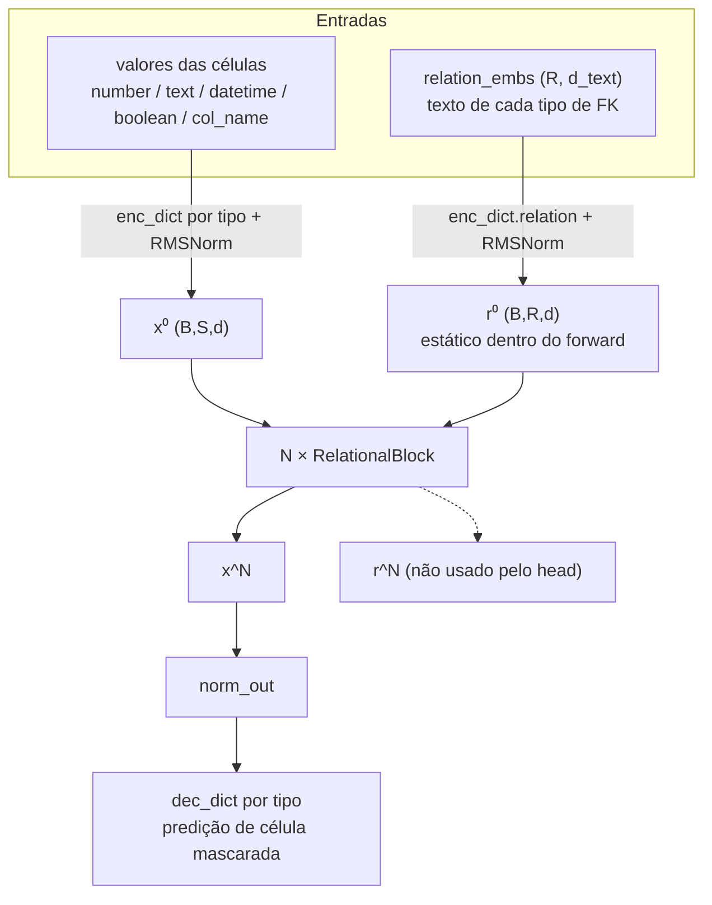
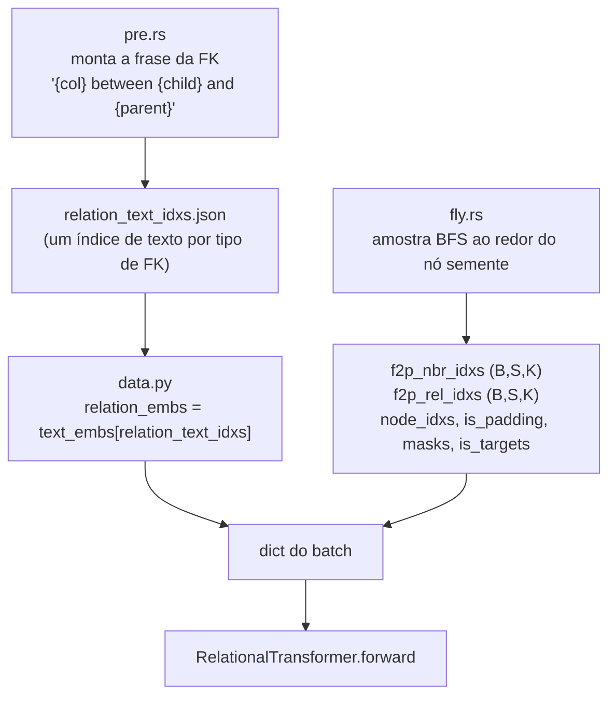
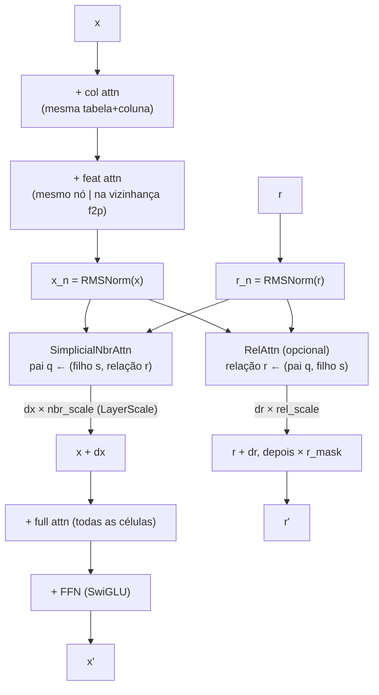
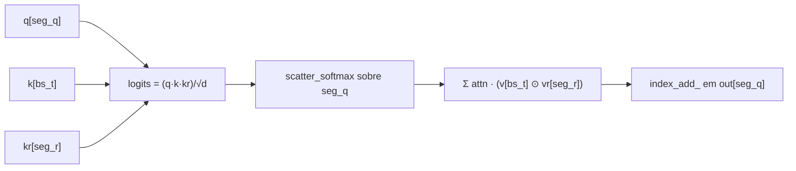

# Atenção simplicial relacional (rota estática de texto-relação)

Pré-treino zero-shot em tabelas relacionais onde a **agregação de vizinhança é
condicionada ao tipo da chave estrangeira**, e cada tipo de relação é representado
pelo **embedding de texto da sua descrição de schema** (ex.: `"director between movie
and person"`).

O principal resultado empírico desta branch é um novo recorde de **305,63 segundos
(5m05,6s)** até o alvo fixo de AUROC pooled `0.81621`, contra 7m26s do recorde
anterior. A receita mantém o stream de relações estático entre blocos
(`update_relations=False`), usa warmup longo do Muon e verifica o primeiro
checkpoint pós-update elegível no step 100.

A evidência canônica é a run W&B
[`ltlneqhn`](https://wandb.ai/franciscokunumi-universidade-federal-de-minas-gerais/nanort-train/runs/ltlneqhn),
que registrou AUROC pooled `0,8713918` na avaliação elegível do step 100. A
configuração completa e a decomposição temporal estão em
[`RECORD_04_MANIFEST.md`](RECORD_04_MANIFEST.md).

Uma auditoria mediu AUROC pooled `0.8651` no step 0. Esse diagnóstico roda fora do
timer e não pode criar recorde nem selecionar checkpoint. “Estático” descreve o
estado de relação dentro do forward; o encoder de relações e a atenção de
vizinhança continuam treináveis.

---

## 1. A ideia em uma linha

A atenção de vizinhança convencional pergunta *"quão relevante é o filho `s` para o
pai `q`?"*. Aqui o score também depende de **qual relação** os conecta:

```
score(q, s, r) = Σ_d  q_d · k^cell_s,d · k^rel_r,d          (por head)
value(s, r)    = v^cell_s ⊙ v^rel_r                          (gate estilo FiLM)
```

`r` é um embedding por tipo de relação, inicializado a partir de texto e — na rota
vencedora — **não atualizado iterativamente** entre os blocos.

> Nota (ver `project_simplicial_diagnosis`): algebricamente isto é um operador
> DistMult/FiLM de rank 1, não um 2-simplex de verdade — `r` está colado à aresta e a
> softmax é segmentada apenas por `q`. O nome "simplicial" é histórico.

---

## 2. Dois streams

O modelo carrega dois streams de tokens através de cada bloco:

- **`x` — células** `(B, S, d)`: um token por célula (linha, coluna) no subgrafo amostrado.
- **`r` — relações** `(B, R, d)`: um token por *tipo* de chave estrangeira,
  compartilhado por todas as arestas que o instanciam.



Só `x` chega ao head de predição; `r` condiciona `x` mas nunca é decodificado.

---

## 3. Pipeline de dados (amostragem à prova de vazamento)

A extensão em Rust (`rustler/`) constrói o texto da relação e amostra um subgrafo
temporal e livre de vazamento por nó semente.



Prevenção de vazamento no `fly.rs` (validada):

| vetor | mecanismo | ref |
|---|---|---|
| temporal | arestas com `timestamp > seed_node.timestamp` são descartadas | `fly.rs:447` |
| valor do alvo | a célula alvo recebe `is_target` + `masks=True`; o modelo usa `mask_emb` na entrada e o valor só como rótulo | `fly.rs:528-532` |
| colunas vazantes | `columns_to_drop` são removidas do nó semente **e** dos nós de mesmo timestamp | `fly.rs:482-483` |
| holdout | `train_tasks` exclui `holdout_db`; a validação carrega só o artefato do holdout → zero-shot | `nanort_train.py:79-82` |

---

## 4. Dentro de um `RelationalBlock`



- `col`/`feat`/`full` são atenções mascaradas padrão (`flex_attention`).
- `SimplicialNbrAttn` atualiza células; `RelAttn` atualiza relações.
- **`update_relations=False`** remove o `RelAttn` inteiro → `r` permanece `r⁰`
  entre os blocos. Esta é a configuração vencedora; gradientes ainda chegam ao
  encoder de relações e ao caminho de atenção de vizinhança.
- `nbr_scale`/`rel_scale` são gates LayerScale por canal sobre os deltas
  (`simplicial_layerscale_init`, default 1.0 = residual simples).
- O stream de relações é re-mascarado com `r_mask` depois de cada bloco (defensivo; o
  encoder de relação tem bias).

---

## 5. Edge-scatter esparso (por que caber na memória)

Logits densos `(B, H, S, S, K)` explodiriam. `build_rel_batch` compila os slots de FK
válidos em triplas de arestas achatadas, uma vez por batch:

```
seg_q = b·S + q   (célula pai)      → queries; segmenta a softmax e espalha a saída
bs_t  = b·S + s   (célula filho)    → keys/values
seg_r = b·R + r   (tipo de relação) → K/V da relação; segmenta o RelAttn
```

O `SimplicialNbrAttn` então faz, sobre as `T` arestas (tudo
`index_select`/`index_add_`, para o tráfego de índices ficar em 1-D):



RMSNorm por head (`qk_norm`) é aplicado a `q`, `k` e `kr` antes do produto trilinear,
para a escala do logit trilinear não colapsar a entropia da softmax.

---

## 6. SIGReg (regularização geométrica)

O `SIGReg` regulariza o estado oculto por célula depois do bloco `sigreg_layer`
(visões de linha/coluna derivadas de `node_idxs` e da chave (tabela, coluna)). Loss
auxiliar apenas em treino: `(1-λ_row-λ_col)·L_sup + λ_row·row + λ_col·col`, treinada
por um AdamW fp32 separado. O recorde usa a visão global de coluna depois do
bloco 0 com `λ_col=1e-3`; `sigreg_layer=None` e lambdas zero desativam o módulo
nas ablations.

---

## 7. Receita de treino (o resultado)

| ingrediente | valor | por quê |
|---|---|---|
| stream de relações | **estático** (`update_relations=False`) | o `RelAttn` dinâmico corrompia o prior de texto (one-hot, norma de `r` ×4) |
| simplicial | todos os blocos | condiciona a agregação de vizinhança ao prior de texto limpo |
| optimizer | Muon (pesos 2-D) + AdamW (o resto) | |
| **warmup do muon** | **3000 steps** | sustenta o init forte; o modelo se afasta dele mesmo com LR minúsculo |
| SIGReg | bloco 0, visão global de coluna, `λ_col=1e-3` | regulariza a geometria da representação inicial |
| eval oficial | step 100 (`eval_at_step1=False`) | primeiro crossing pós-update elegível no recorde |
| eval diagnóstico | step 0 | fora do timer; não cria recorde/checkpoint |
| checkpoint | melhor AUROC pooled pós-update elegível | o step 0 é excluído explicitamente |

Métrica: `time_to_target` = segundos de wall-clock histórico até o AUROC pooled
(`val/auroc_pooled`, alias legado `val/auroc_zero_shot`) cruzar **0.81621** pela
primeira vez no banco de holdout. O timer inclui as avaliações agendadas depois
que começa; não é apenas tempo de kernel ou optimizer.

---

## 8. Resumo do diagnóstico

- A arquitetura inicializada completa já tem sinal zero-shot forte: pooled
  `0.8651` e média por tarefa `0.5682` na run auditada. Qual canal de entrada causa
  esse sinal precisa ser isolado por ablation; uma única run não permite atribuí-lo.
- O pooled é fortemente influenciado pelo alinhamento entre tarefas. AUROC por
  tarefa e a decomposição exata within/cross são diagnósticos obrigatórios, sem
  alterar a métrica oficial histórica.
- LR baixo / warmup longo preservam a solução inicial até a verificação elegível;
  ganhos pós-init devem ser reportados separadamente.
- O operador atual é uma interação trilinear fatorada/FiLM sobre arestas FK
  tipadas, não um complexo simplicial explícito. Um operador de ordem 2 genuíno
  (segundo endpoint livre + softmax conjunta) é direção de pesquisa aberta.
